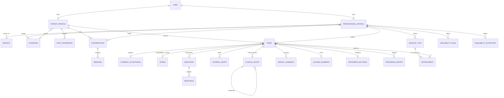
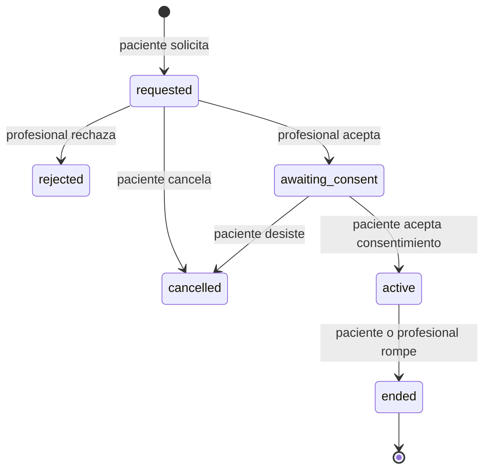
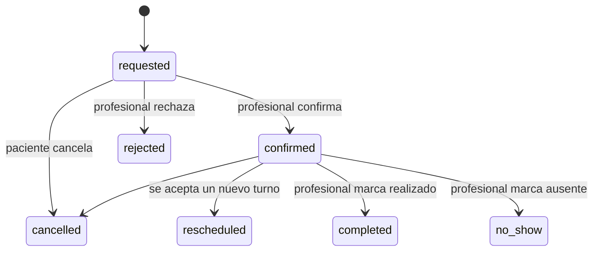
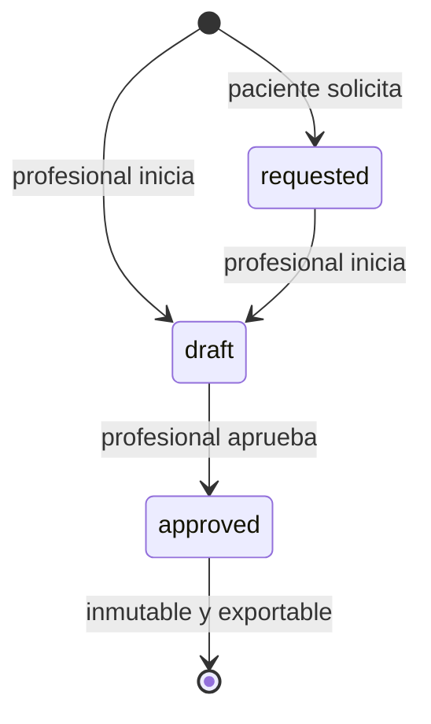
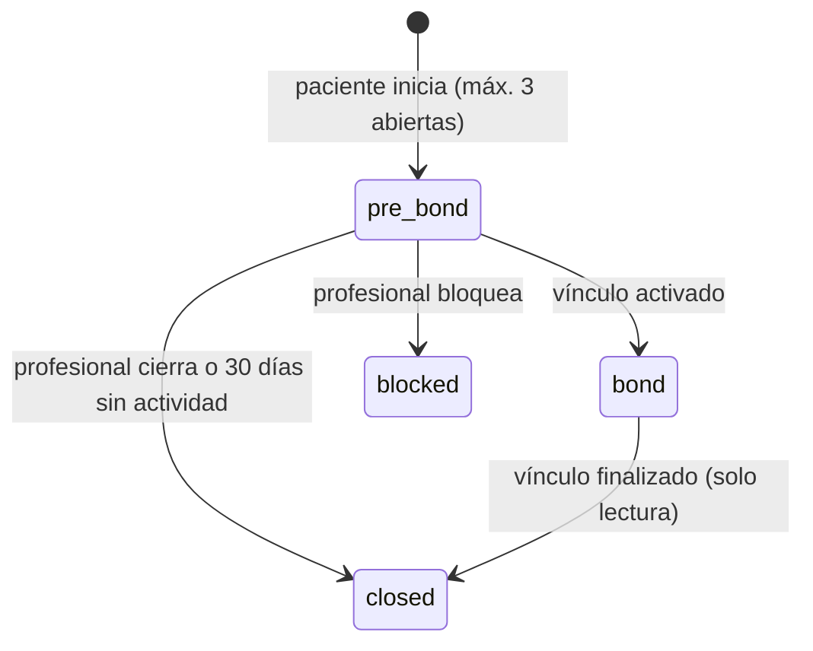

# 04 — Modelo de datos

PostgreSQL (Neon). Todos los IDs son `uuid` o `text` (los de Better Auth). Todas las tablas llevan `created_at`. Las editables llevan `updated_at`. **No hay borrado físico** de datos clínicos.

## 1. Diagrama general



## 2. Entidades

### 2.1 Identidad (Better Auth + extensión)

**user** (Better Auth): `id`, `name`, `email`, `email_verified`, `image`, más los campos extendidos:
- `role`: `patient | professional | admin`
- `birth_date`: date (validación de 18 años o más)
- `status`: `active | suspended`

Además, `session`, `account` y `verification` (Better Auth).

### 2.2 Perfiles

**professional_profile**
| Campo | Tipo | Nota |
|-------|------|------|
| id | uuid | |
| user_id | fk user | único |
| display_name | text | |
| photo_url | text | Blob |
| bio | text | |
| license_number | text | matrícula |
| license_jurisdiction | text | provincia o colegio |
| license_verified | bool | `false` por defecto (P-03) |
| theoretical_approach | text[] | catálogo sugerido + libre |
| modality | enum `in_person, online, both` | |
| province, city, address | text | dirección opcional |
| languages | text[] | |
| fee_min, fee_max | int | ARS, referencia |
| accepts_new_patients | bool | |
| is_published | bool | |
| search_text | tsvector | búsqueda de texto |

**professional_branch** (N:M): `professional_id`, `branch_id`
**professional_coverage** (N:M): `professional_id`, `coverage_id`, `notes`

**patient_profile**
| Campo | Tipo | Nota |
|-------|------|------|
| id | uuid | |
| user_id | fk user | único |
| first_name, last_name | text | |
| dni | text | cifrado en reposo (columna) |
| gender | text | opcional |
| phone | text | |
| province, city | text | |
| coverage_id | fk coverage | opcional |
| coverage_member_number | text | opcional |
| emergency_contact_name, emergency_contact_phone | text | |
| initial_topics | text | texto libre (temas iniciales) |

**past_experience**: `id`, `patient_id`, `period_from`, `period_to`, `reason`, `outcome`, `professional_id` (nullable, de la plataforma), `external_professional_name` (nullable), `closing_summary_id` (nullable).

### 2.3 Catálogos (Admin)

**branch**: `id`, `slug`, `name`, `description`, `parent_id` (nullable, para subramas), `sort`, `active`.
**coverage**: `id`, `name`, `type` (`public_program | obra_social | prepaga | other`), `jurisdiction` (nacional o provincia), `external_code` (para integración estatal), `active`.
**benefit**: `id`, `coverage_id`, `description`, `discount_type` (`percent | fixed | full`), `value`, `valid_from`, `valid_to`. Modela las bonificaciones estatales.
**consent_version**: `id`, `kind` (`informed_consent | terms | privacy`), `version`, `body_md`, `published_at`, `is_current`.
**clinical_template**: `id`, `owner_professional_id` (null = global), `name`, `entry_kind`, `sections` (jsonb: `[{title, hint}]`).
**platform_setting**: `key`, `value` (jsonb).

### 2.4 Conexión

**conversation**: `id`, `patient_id`, `professional_id`, `bond_id` (nullable), `status` (`pre_bond | bond | closed | blocked`), `last_message_at`.
**message**: `id`, `conversation_id`, `sender_user_id`, `body`, `attachment_url` (nullable), `read_at`.

**bond** (vínculo terapéutico)
| Campo | Tipo |
|-------|------|
| id | uuid |
| patient_id, professional_id | fk |
| status | `requested, awaiting_consent, active, rejected, cancelled, ended` |
| request_message | text |
| rejection_reason | text |
| ended_by | `patient, professional` |
| end_reason | text |
| requested_at, accepted_at, activated_at, ended_at | timestamptz |

Restricción R-12: índice único parcial `bond(patient_id) WHERE status IN ('requested', 'awaiting_consent', 'active')`.

**consent_acceptance**: `id`, `bond_id`, `consent_version_id`, `accepted_at`, `ip`, `user_agent`.

Campos adicionales de conversación (P-12): `patient_messages_before_reply` (int), `closed_reason` (`professional | inactivity | bond_ended`).

### 2.5 Agenda

**service_type**: `id`, `professional_id`, `name`, `duration_min`, `modality`, `fee`, `is_first_consultation`, `active`.
**service_type_coverage** (N:M) con `service_type_id`, `coverage_id`.
**availability_rule**: `id`, `professional_id`, `weekday` (0 a 6), `start_time`, `end_time`, `modality`, `valid_from`, `valid_to`.
**availability_exception**: `id`, `professional_id`, `date`, `start_time`, `end_time`, `kind` (`block | extra`).
**professional_agenda_settings**: `professional_id`, `min_booking_notice_hours` (12), `min_cancel_notice_hours` (24), `request_expiry_hours` (48), `timezone` (por defecto `America/Argentina/Buenos_Aires`). Los valores por defecto salen de `platform_setting` (P-05).

**appointment**
| Campo | Tipo |
|-------|------|
| id | uuid |
| professional_id, patient_id | fk |
| bond_id | fk nullable (primera consulta con vínculo pendiente) |
| service_type_id | fk |
| starts_at, ends_at | timestamptz |
| modality | enum |
| status | `requested, confirmed, rejected, cancelled, rescheduled, completed, no_show` |
| cancelled_by, cancel_reason, late_cancellation | |
| rescheduled_from_id | fk appointment |
| patient_reschedule_count | int (máximo 1) |
| expires_at | timestamptz (solo `requested`) |
| video_room_name | text (Daily) |

Restricción: no se superponen turnos `requested` o `confirmed` del mismo profesional (constraint de exclusión con `tstzrange`).

### 2.6 Historia clínica

**clinical_entry**
| Campo | Tipo | Nota |
|-------|------|------|
| id | uuid | |
| bond_id | fk | |
| author_professional_id | fk | |
| kind | `starting_point, first_impressions, evolution, amendment` | |
| amends_entry_id | fk nullable | solo si `kind = amendment` |
| appointment_id | fk nullable | |
| template_id | fk nullable | |
| content | jsonb | secciones `{title, body}` |
| content_hash | text | SHA-256 del contenido, autor y fecha (integridad) |
| author_license_snapshot | text | matrícula al momento de escribir |
| created_at | timestamptz | |

Inmutable: sin `UPDATE` ni `DELETE` desde la aplicación. Se garantiza en la capa de servicio y con un trigger que rechaza `UPDATE` y `DELETE`.

**intake** (necesidades y motivo): `id`, `bond_id` (único), `needs`, `reason_to_start`, `submitted_at`. Inmutable después del envío.

### 2.7 Seguimiento

**journal_entry**: `id`, `bond_id`, `patient_id`, `kind` (`conflict | need | other`), `body`, `mood` (1 a 5, nullable), `week_start` (date, lunes), `editable_until`, `read_by_professional_at`.
> El diario pertenece al vínculo (P-01). Al cambiar de profesional, el diario anterior no se transfiere (R-13).

**indication**: `id`, `bond_id`, `title`, `description`, `kind` (`guideline | exercise | reading | other`), `frequency` (text), `valid_until`, `status` (`active | archived`), `patient_seen_at`.
**indication_comment**: `id`, `indication_id`, `author_user_id`, `body`.
**resource**: `id`, `indication_id` (nullable), `message_id` (nullable), `type` (`file | link`), `url`, `name`.

**weekly_summary**: `id`, `bond_id`, `week_start`, `data` (jsonb agregado), `ai_text` (nullable), `professional_annotation`, `shared_with_patient` (bool), `generated_at`. Único `(bond_id, week_start)`.

**closing_summary**: `id`, `bond_id` (único), `status` (`requested | draft | approved`), `requested_by_patient_at`, `content` (jsonb o markdown), `approved_at`, `pdf_url`.

**progress_settings**: `bond_id`, `format` (`stages | percent | scale_10`), `stages` (jsonb, si aplica), `visibility_policy` (`patient_decides | recommend_show | recommend_hide | blocked`), `recommendation_message`, `patient_wants_to_see` (bool).
**progress_update**: `id`, `bond_id`, `format` (el vigente al registrar), `value` (numeric o índice de etapa), `note`, `clinical_entry_id` (nullable), `created_at`.
Etapas por defecto (P-11): Evaluación, Inicio, Desarrollo, Consolidación, Cierre.

### 2.8 Transversal

**notification**: `id`, `user_id`, `type`, `payload` (jsonb), `read_at`.
**audit_log**: `id`, `actor_user_id`, `action` (`read | create | amend | export | ...`), `entity`, `entity_id`, `bond_id`, `ip`, `created_at`. Solo inserción.
**clinical_record_request**: `id`, `bond_id`, `requested_at`, `due_at` (`requested_at` + 48 h), `fulfilled_at`, `export_url` (P-02, R-14).

## 3. Catálogos iniciales

### 3.1 Catálogo inicial de ramas

Adoptado (P-07).

Áreas de aplicación reconocidas en la formación de grado y en los colegios de psicólogos de Argentina. Se proponen como ramas de primer nivel, con subramas clínicas por población o problemática para la búsqueda.

1. **Psicología clínica**
   - Adultos
   - Parejas
   - Familias
   - Adultos mayores (gerontología)
   - Adicciones
   - Trastornos de la conducta alimentaria
   - Duelo y pérdidas
   - Ansiedad y estrés
   - Trauma
   - Diversidad sexual y de género
2. **Psicología de la salud / sanitaria**
3. **Neuropsicología**
4. **Psicología laboral y organizacional**
5. **Psicología educacional**
6. **Psicología jurídica y forense**
7. **Psicología social y comunitaria**
8. **Psicología del deporte**
9. **Psicología de la emergencia y catástrofes**

**Enfoque teórico** (atributo separado, no rama): psicoanálisis, cognitivo-conductual, sistémico, gestáltico, humanista-existencial, integrativo, terapias de tercera generación (ACT, DBT) y otros.

> Las subramas infantojuveniles se excluyen porque solo se atiende a mayores de edad.

### 3.2 Programas y coberturas de ejemplo (seed)
- Programa público de ejemplo nacional, con bonificación total.
- Programa provincial de ejemplo, con bonificación del 50 %.
- Dos obras sociales y una prepaga de ejemplo.

Son datos ficticios. Admin los reemplaza por los reales.

## 4. Máquinas de estado

### 4.1 Vínculo



### 4.2 Turno



### 4.3 Resumen de cierre



### 4.3b Conversación



### 4.4 Visibilidad del progreso (regla efectiva)

```
visible_para_paciente =
  policy != 'blocked' AND patient_wants_to_see = true
```
`recommend_show` y `recommend_hide` solo muestran `recommendation_message` al paciente al momento de decidir.
