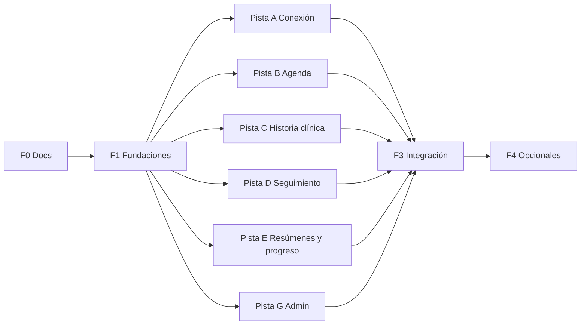

# 06 — Roadmap y plan de commits

Cada tarea es **un commit o PR** que deja la app funcionando y verificable en la preview. Las reglas de trabajo entre agentes están en [07 — Guía de desarrollo](./07-guia-de-desarrollo.md).

Estado: `[ ]` pendiente · `[~]` en curso · `[x]` hecho · Asignado: `@agente`

---

## Estrategia

1. **Fase 1 (secuencial, un solo agente):** se construyen todos los contratos compartidos: tokens, shells, mapa de rutas, **esquema completo** de base de datos, auth, servicios base, políticas, interfaces de mocks y seed con datos de todos los módulos.
2. **Fase 2 (paralela, hasta 6 agentes):** cada pista trabaja en su módulo y en sus carpetas. Las pistas **no dependen entre sí** porque el seed de F1 ya crea vínculos en todos los estados, turnos, diarios e indicaciones de ejemplo. Por ejemplo, la pista de historia clínica no espera a que esté hecho el flujo de vínculo.
3. **Fase 3 (secuencial):** integración (inicios por rol, notificaciones), endurecimiento, API estatal y recorrido de demo.
4. **Fase 4 (opcional):** reemplazo de mocks por servicios reales.

---

## Fase 0 — Documentación

### [x] F0-01 Documentación técnica
Documentos 01 a 07. Decisiones P-01 a P-12 resueltas.

---

## Fase 1 — Fundaciones (secuencial)

Orden obligatorio: F1-01 → F1-02 → F1-03 → F1-04 → F1-05 → F1-06. Al terminar F1, los **archivos compartidos quedan congelados** (ver guía §3).

### [ ] F1-01 Sistema de diseño
- **Objetivo:** tokens estilo Fluent 2 intercambiables.
- **Entregables:**
  - `app/globals.css`: colores semánticos (claro y oscuro), `--surface-1..3`, `--success`, `--warning`, `--danger`, radios, elevaciones `--shadow-2/4/8/16`, tipografía en `--font-sans`.
  - `app/layout.tsx`: fuente, metadata, viewport, `lang="es-AR"`, clase de fondo en `<html>`.
  - `components/ui/icon.tsx`: wrapper único de iconos.
  - Ajuste de primitivas shadcn al lenguaje Fluent (radios, foco de 2 px, targets de 44 px).
  - Página interna `/_design` con todas las primitivas para revisión visual.
- **Docs:** 05 §4.
- **Aceptación:** cambiar `--primary` y `--font-sans` cambia toda la app. Sin colores directos fuera de `globals.css`. Modo oscuro correcto.

### [ ] F1-02 Shells, rutas y navegación
- **Objetivo:** que todas las rutas existan desde el inicio, para que las pistas no editen la navegación.
- **Entregables:**
  - `lib/navigation.ts`: mapa de **todas** las rutas del doc 05 §2 con etiqueta, icono y rol.
  - `components/layout/`: shell público, de paciente, de profesional y de admin. Navegación inferior en mobile y lateral desde 1024 px.
  - Una página placeholder por ruta con su título y el estado "En construcción (tarea X)".
  - Componentes de estado compartidos: `EmptyState`, `PageHeader`, `LoadingSkeleton`, `ErrorState`.
- **Docs:** 05 §2, §4.
- **Aceptación:** se navega por todas las rutas en 375 px y 1280 px. Cada placeholder indica qué tarea la implementa.

### [ ] F1-03 Base de datos y esquema completo
- **Objetivo:** el modelo del doc 04 completo, para que ninguna pista necesite migraciones estructurales.
- **Entregables:**
  - Conectar Neon. `lib/db/index.ts`.
  - `lib/db/schema/`: `identity`, `catalog`, `connection`, `agenda`, `clinical`, `follow-up`, `summaries`, `platform`, e `index.ts`.
  - Migración inicial con: índice único parcial de R-12, constraint de exclusión de turnos superpuestos, triggers que rechazan `UPDATE` y `DELETE` en `clinical_entry`, `intake` y `audit_log`.
  - `lib/crypto.ts`: cifrado de columna para el DNI (`FIELD_ENCRYPTION_KEY`).
- **Docs:** 04 completo.
- **Aceptación:** la migración corre en una base vacía. Un `UPDATE` directo sobre `clinical_entry` falla. Dos vínculos abiertos del mismo paciente fallan.

### [ ] F1-04 Autenticación y roles
- **Entregables:**
  - Better Auth con email y contraseña, campos `role`, `birth_date` y `status`.
  - `/registro` con elección de rol, validación de 18 años o más y aceptación de términos y privacidad. `/ingresar`. Cierre de sesión.
  - `lib/session.ts`: `getSession()`, `requireRole(role)`. Guards en los layouts de `/paciente`, `/profesional` y `/admin`.
  - Redirección al panel del rol después de iniciar sesión.
- **CU:** A-01, A-02 · **Reglas:** R-06 · **Docs:** 02 §1, 05 §5.
- **Aceptación:** un paciente no entra a `/profesional` ni a `/admin`. Un menor de 18 no puede registrarse. Un usuario suspendido no inicia sesión.

### [ ] F1-05 Servicios base, políticas e interfaces
- **Objetivo:** dejar los contratos que usan todas las pistas.
- **Entregables:**
  - `lib/services/_base.ts`: patrón de servicio (recibe la sesión, valida con Zod y autoriza) y errores tipados (`Forbidden`, `NotFound`, `RuleViolation` con código de regla).
  - `lib/services/bond-access.ts`: `getOpenBondForPatient()`, `requireBondAccess(session, bondId, mode)` con lectura activa, lectura histórica (R-03) y escritura.
  - `lib/policies/`: funciones puras con tests para R-01, R-02, R-03, R-05, R-07, R-09, R-10, R-12 y R-14.
  - `lib/audit.ts` (`audit.log()`), `lib/notifier/` (`Notifier` y la implementación sobre la tabla `notification`).
  - Interfaces y mocks: `lib/recommendation/` (`RecommendationEngine` y `mockEngine`), `lib/summaries/` (`SummaryWriter` y `mockWriter`), `lib/video/` (`VideoProvider` y `dailyProvider`), `lib/storage/` (subida y descarga privada con Blob).
  - Vitest configurado y script `test`.
- **Docs:** 02 §3, 05 §3, §8.
- **Aceptación:** los tests de políticas pasan. Ninguna interfaz tiene lógica de UI.

### [ ] F1-06 Seed de demo
- **Objetivo:** datos para que cada pista trabaje sin esperar a otras.
- **Entregables:** `lib/db/seed/` con un archivo por módulo y `seed/index.ts`, más un script `db:seed` idempotente.
  - Catálogos: ramas (doc 04 §3.1), enfoques, coberturas y programas con bonificaciones (§3.2), consentimiento v1, términos y privacidad, 3 plantillas globales y la configuración por defecto (P-05, R-07, P-11).
  - Usuarios: 1 admin, 10 profesionales publicados con atenciones y disponibilidad, y 5 pacientes.
  - Vínculos cubriendo **todos los estados**: `requested`, `awaiting_consent`, 2 `active` con 6 semanas de historia (turnos realizados, historia clínica, diario, indicaciones, resúmenes semanales y progreso) y 1 `ended` con resumen de cierre aprobado.
  - Conversaciones pre-vínculo y de vínculo con mensajes.
  - Credenciales de demo documentadas en `docs/demo.md`.
- **Aceptación:** `db:seed` se puede correr dos veces sin duplicar. Con cada usuario de demo se ve un caso distinto.

---

## Fase 2 — Pistas paralelas

Cada pista tiene un **dueño** y sus propias carpetas (ver guía §3). Dentro de una pista, las tareas van en orden.

### Pista A — Conexión pública

Carpetas: `app/(public)`, `app/paciente/perfil`, `app/paciente/profesionales`, `app/paciente/mensajes`, `app/paciente/historial` (solo experiencias pasadas), `app/profesional/perfil`, `app/profesional/solicitudes`, `app/profesional/mensajes`, `components/domain/{search,bond,chat,profile}`, `lib/services/{profiles,search,chat,bonds}.ts`.

#### [ ] A-01 Perfiles
- Onboarding y edición del perfil profesional con foto (Blob). Publicación cuando están los campos obligatorios.
- Perfil público `/profesionales/[id]` con ramas, enfoques, atenciones, coberturas, próxima disponibilidad y "Matrícula no verificada".
- Perfil del paciente con datos personales (DNI cifrado), cobertura y temas iniciales.
- Experiencias pasadas: alta, edición, profesional de la plataforma o externo, adjuntar un resumen de cierre propio.
- **CU:** A-03, A-04, A-05, A-06, B-03 · **Reglas:** R-13.
- **Aceptación:** un perfil incompleto no aparece en búsquedas. El DNI no se guarda en texto plano.

#### [ ] A-02 Búsqueda y recomendaciones
- Landing con buscador doble: filtros y lenguaje natural.
- `/buscar`: filtros por rama, modalidad, provincia o localidad, cobertura o programa, honorarios, idioma y "disponible esta semana". Estado en la URL.
- Lenguaje natural con `mockEngine`: temas detectados, ramas sugeridas, profesionales recomendados con su motivo, y aviso de que es una orientación y no un diagnóstico.
- Etiqueta "Atiende por [programa]" y precio bonificado si el paciente tiene cobertura.
- Se puede activar o desactivar desde la configuración de admin.
- **CU:** B-01, B-02 · **Docs:** 05 §7, §8.
- **Aceptación:** buscar sin cuenta funciona. Las acciones de contacto piden iniciar sesión. Los filtros se pueden compartir por URL.

#### [ ] A-03 Chat
- Iniciar conversación desde el perfil. Lista de conversaciones y vista de conversación con polling SWR (5 s) e indicador de no leídos.
- Límites de R-09: 3 conversaciones abiertas, 3 mensajes antes de la respuesta. Cerrar y bloquear desde el profesional.
- Adjuntos durante el vínculo (Blob privado).
- Cron `chat-inactivity` (30 días).
- **CU:** B-04, B-09 · **Reglas:** R-09.
- **Aceptación:** el 4.º mensaje sin respuesta se rechaza con un mensaje claro. Un paciente bloqueado no puede escribir.

#### [ ] A-04 Vínculo, consentimiento e intake
- Solicitar vínculo con mensaje y primera consulta opcional (usa el servicio de turnos de B-02; si todavía no está, se oculta el selector).
- Bandeja de solicitudes del profesional con `PatientPreview` (R-01). Aceptar o rechazar con motivo.
- Aceptación del consentimiento vigente (versión, fecha, IP y user agent).
- Formulario único de necesidades y motivo de inicio después de la activación.
- Romper el vínculo: cancela turnos futuros, deja la conversación en solo lectura y crea la experiencia pasada (R-13).
- Error claro de R-12 si ya hay un vínculo abierto.
- **CU:** B-05 a B-08, E-01 · **Reglas:** R-01, R-02, R-03, R-08, R-12, R-13.
- **Aceptación:** recorrido completo solicitud → aceptación → consentimiento → intake → ruptura en la preview.

### Pista B — Agenda y sesiones

Carpetas: `app/profesional/agenda`, `app/paciente/turnos`, `app/sesion`, `app/api/cron/reminders`, `components/domain/agenda`, `lib/services/agenda.ts`, `lib/agenda/` (cálculo de turnos).

#### [ ] B-01 Atenciones y disponibilidad
- CRUD de tipos de atención (nombre, duración, modalidad, honorario, coberturas, "primera consulta").
- Disponibilidad recurrente semanal y excepciones (bloqueo y franja extra).
- Ajustes de anticipación (P-05) con los valores por defecto de la plataforma.
- **CU:** C-01, C-02.

#### [ ] B-02 Turnos libres, solicitud y confirmación
- `lib/agenda/slots.ts` (función pura con tests): reglas menos excepciones menos turnos ocupados, respetando la anticipación y la zona horaria de Argentina.
- El paciente elige la atención y el turno, y lo solicita. El profesional confirma o rechaza.
- Agenda del profesional: vista de día y semana en desktop, lista en mobile.
- Exportar servicio `getAvailableSlots()` para A-01 y A-04.
- **CU:** C-03, C-04 · **Reglas:** R-10.
- **Aceptación:** dos solicitudes simultáneas para el mismo turno: una falla (constraint de exclusión).

#### [ ] B-03 Ciclo de vida del turno
- Cancelar (cancelación tardía), reprogramar (una vez el paciente), marcar realizado o ausente.
- Vencimiento automático de turnos sin confirmar.
- **CU:** C-05, C-06, C-08 · **Reglas:** R-10.

#### [ ] B-04 Recordatorios
- Cron `reminders` cada 15 min: notificaciones 24 h y 1 h antes, y vencimientos. Protegido con `CRON_SECRET`. Configuración en `vercel.json`.
- **CU:** C-07.

#### [ ] B-05 Sesión online
- `/sesion/[appointmentId]`: autorización (solo los dos participantes), botón habilitado 10 minutos antes, sala Daily embebida con token por usuario.
- Aviso y botón deshabilitado si falta `DAILY_API_KEY`.
- `Permissions-Policy` de cámara y micrófono para el dominio de Daily.
- **CU:** C-09 · **Docs:** 01 P-04.
- **Aceptación:** un tercero autenticado recibe 403 en la sala.

### Pista C — Historia clínica

Carpetas: `app/profesional/pacientes/[bondId]/historia-clinica`, `app/profesional/plantillas`, `components/domain/clinical`, `lib/services/clinical.ts`, `lib/pdf/clinical-record.tsx`.

#### [ ] C-01 Entradas y enmiendas
- Punto de inicio y primeras impresiones (una por vínculo), notas de evolución asociables a un turno realizado.
- Enmiendas vinculadas. El original se ve como "enmendado".
- Hash SHA-256 y snapshot de la matrícula. Auditoría de cada lectura y escritura.
- **CU:** D-01 a D-04 · **Reglas:** R-04, R-11.
- **Aceptación:** no existe acción de editar ni borrar. El hash se verifica en la vista.

#### [ ] C-02 Plantillas
- Plantillas propias del profesional, duplicar una global, aplicar una plantilla al crear una entrada.
- **CU:** D-05 · **Docs:** 01 P-10.

#### [ ] C-03 Ficha del paciente y línea de tiempo
- `/profesional/pacientes` (lista de vínculos activos y finalizados) y `/profesional/pacientes/[bondId]` (ficha con datos según R-02 o R-03, y línea de tiempo con entradas, turnos, indicaciones y resúmenes).
- La línea de tiempo expone un **registro de fuentes**: cada pista agrega su tipo de evento en `lib/timeline/sources/<pista>.ts`, sin editar el componente.
- **CU:** D-06 · **Reglas:** R-02, R-03.

#### [ ] C-04 Copia de historia clínica
- Solicitud del paciente desde `/paciente/historial`, bandeja con vencimiento de 48 h para el profesional, exportación en PDF, entrega y descarga.
- **CU:** D-07 · **Reglas:** R-14, R-15.

### Pista D — Seguimiento del paciente

Carpetas: `app/paciente/tratamiento`, `app/paciente/diario`, `app/profesional/pacientes/[bondId]/{indicaciones,diario}`, `components/domain/{indications,journal}`, `lib/services/{indications,journal}.ts`.

#### [ ] D-01 Indicaciones y recursos
- El profesional crea, edita y archiva indicaciones con tipo, frecuencia, vigencia y recursos (archivos o enlaces).
- El paciente ve las vigentes y archivadas, las marca como vistas y comenta.
- Descarga de archivos por handler que valida el vínculo.
- **CU:** E-04, E-05, E-06.

#### [ ] D-02 Diario del paciente
- Crear entradas (conflicto, necesidad, otro) con estado de ánimo opcional, agrupadas por semana. Edición durante la ventana configurada.
- Diseño de escritura rápida en mobile.
- **CU:** E-02 · **Reglas:** R-07, R-12.

#### [ ] D-03 Diario desde el profesional
- Vista por semana con polling, indicador de no leídas, marcar como leídas al ver.
- **CU:** E-03.

### Pista E — Resúmenes y progreso

Carpetas: `app/profesional/pacientes/[bondId]/{resumenes,progreso,cierre}`, `app/paciente/progreso`, `app/paciente/historial` (resúmenes de cierre), `app/api/cron/weekly-summaries`, `app/api/export`, `components/domain/{summaries,progress}`, `lib/services/{summaries,progress,closing}.ts`, `lib/summaries/aggregate.ts`, `lib/pdf/closing-summary.tsx`.

#### [ ] E-01 Resumen semanal
- `aggregate.ts` (función pura con tests): diario por tipo, estado de ánimo, indicaciones vistas o comentadas, turnos y mensajes.
- Cron de los lunes a las 00:00 de Argentina, idempotente por `(bond_id, week_start)`.
- Vista del profesional con anotación privada y opción de compartir con el paciente. Botón "Redactar con IA" (mock).
- **CU:** F-01, F-02 · **Docs:** 01 P-06.

#### [ ] E-02 Resumen histórico
- Vista consolidada del vínculo: punto de inicio, gráfico de progreso, resúmenes acumulados, hitos y redacción opcional con IA (mock).
- **CU:** F-03.

#### [ ] E-03 Progreso
- Configuración por vínculo: formato (etapas, porcentaje o escala) y política de visibilidad.
- Registro de actualizaciones (también desde una nota de evolución de C-01 si ya existe).
- Gráfico con la skill de charts. Vista del paciente con el interruptor "Ver mi progreso", la recomendación o el aviso de bloqueo.
- **CU:** F-06, F-07, F-08 · **Reglas:** R-05 · **Docs:** 01 P-11, 04 §4.4.

#### [ ] E-04 Resumen de cierre
- Solicitud del paciente, borrador precargado, edición y aprobación del profesional, inmutabilidad.
- Exportación en PDF. Adjuntar el resumen a la experiencia pasada del paciente.
- **CU:** F-04, F-05 · **Reglas:** R-13.

### Pista G — Administración

Carpetas: `app/admin/**`, `components/domain/admin`, `lib/services/admin/*.ts`.

#### [ ] G-01 Catálogos
- Ramas (con subramas y orden), enfoques, coberturas y programas, bonificaciones.
- **CU:** G-01, G-02.

#### [ ] G-02 Consentimientos, plantillas y configuración
- Versiones del consentimiento, términos y privacidad (publicar una versión nueva no altera las aceptaciones previas).
- Plantillas globales. Parámetros de la plataforma (P-05, R-07, P-11, cierre semanal, lenguaje natural activado).
- **CU:** G-03, G-04, G-05.

#### [ ] G-03 Usuarios y auditoría
- Lista de usuarios con suspensión y reactivación, sin datos clínicos.
- Visor del registro de auditoría con filtros.
- **CU:** G-06, G-07 · **Reglas:** R-11.

---

## Fase 3 — Integración y cierre (secuencial)

### [ ] F3-01 Inicios por rol y notificaciones
- Inicio del paciente: próximo turno, indicaciones nuevas, acceso rápido al diario y estado del vínculo.
- Inicio del profesional: agenda del día, solicitudes pendientes, diarios no leídos y copias de historia clínica por vencer.
- Inicio del admin: contadores de catálogo y usuarios.
- Centro de notificaciones con contador en la navegación.
- Cada pista deja su widget en `components/domain/<pista>/widgets/`; esta tarea solo los ubica.

### [ ] F3-02 Endurecimiento
- Headers de seguridad (doc 05 §5) y CSP en report-only.
- Revisión de autorización: cada función de `lib/services` tiene un test de acceso denegado.
- Revisión de validación Zod en todas las Server Actions.

### [ ] F3-03 Preparación estatal
- `/api/public/v1/practitioners` y `/api/public/v1/programs` con forma tipo FHIR (`Practitioner`, `HealthcareService`).
- Estadísticas anonimizadas de uso por programa.
- Interfaz `LicenseVerifier` con implementación nula.
- **Docs:** 05 §7.

### [ ] F3-04 Calidad y recorrido de demo
- Revisión responsive (375, 768, 1280 px) y de accesibilidad (teclado, foco, contraste, `aria`).
- `docs/demo.md`: guion paso a paso con los usuarios de demo que recorre todos los CU.
- Verificación del guion completo en el navegador.

---

## Fase 4 — Opcionales

| ID | Tarea | Requiere |
|----|-------|----------|
| F4-01 | Recordatorios por email con Resend (implementación de `Notifier`) | Integración Resend |
| F4-02 | Resúmenes con IA real (`SummaryWriter` con AI SDK y AI Gateway, datos seudonimizados) | — |
| F4-03 | Lenguaje natural con IA real (`RecommendationEngine` con salida estructurada) | — |
| F4-04 | Verificación de matrícula (REFEPS) | Acceso a la fuente oficial |
| F4-05 | Tiempo real con websockets en chat y diario | Proveedor de tiempo real |
| F4-06 | Firma digital de entradas clínicas (Ley 25.506) | Proveedor de firma |

---

## Trazabilidad CU → tarea

| CU | Tarea | CU | Tarea |
|----|-------|----|-------|
| A-01, A-02 | F1-04 | D-01 a D-04 | C-01 |
| A-03 a A-06 | A-01 | D-05 | C-02 |
| B-01, B-02 | A-02 | D-06 | C-03 |
| B-03 | A-01 | D-07 | C-04 |
| B-04, B-09 | A-03 | E-01 | A-04 |
| B-05 a B-08 | A-04 | E-02 | D-02 |
| C-01, C-02 | B-01 | E-03 | D-03 |
| C-03, C-04 | B-02 | E-04 a E-06 | D-01 |
| C-05, C-06, C-08 | B-03 | F-01, F-02 | E-01 |
| C-07 | B-04 | F-03 | E-02 |
| C-09 | B-05 | F-04, F-05 | E-04 |
| G-01, G-02 | G-01 | F-06 a F-08 | E-03 |
| G-03 a G-05 | G-02 | G-06, G-07 | G-03 |

## Asignación sugerida por cantidad de agentes

| Agentes | Reparto en Fase 2 |
|---------|-------------------|
| 2 | Agente 1: A + G · Agente 2: B + C + D + E |
| 3 | Agente 1: A · Agente 2: B + G · Agente 3: C + D + E |
| 4 | A · B · C + G · D + E |
| 6 | Una pista por agente |
