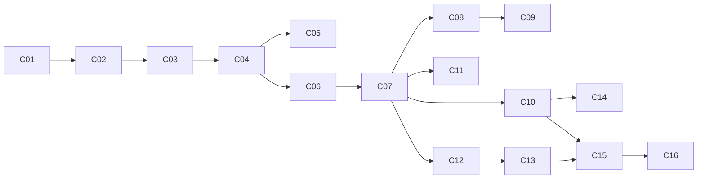

# 06 — Plan de commits

Cada commit deja la app **funcionando** y verificable en la preview. El orden prioriza: base y auth → conexión pública → vínculo → seguimiento (el fuerte) → cierre.

Estado: `[ ]` pendiente · `[~]` en curso · `[x]` hecho

---

### [x] C00 — Documentación técnica
Este conjunto de documentos.

### [ ] C01 — Sistema de diseño y shells
- Tokens estilo Fluent 2 (claro y oscuro), tipografía, radios, elevaciones, wrapper `Icon`.
- Shell público, de paciente, de profesional y de admin. Navegación inferior en mobile y lateral en desktop.
- Páginas vacías con su navegación.
- **Aceptación:** cambiar `--primary` y `--font-sans` cambia toda la app. Se navega en 375 px y en 1280 px.

### [ ] C02 — Base de datos y autenticación
- Conectar Neon. Esquema Drizzle de identidad y perfiles. Better Auth con email y contraseña.
- Registro con elección de rol y validación de 18 años o más. Inicio y cierre de sesión. Guards por rol.
- **CU:** A-01, A-02 · **Reglas:** R-06
- **Aceptación:** un paciente no puede entrar a `/profesional` ni a `/admin`.

### [ ] C03 — Catálogos, seed y panel de admin base
- Ramas, coberturas, programas y beneficios, consentimientos versionados y configuración.
- Seed: catálogo de ramas (P-07), programas de ejemplo, 8 a 10 profesionales, 3 pacientes y 1 admin.
- **CU:** G-01, G-02, G-03, G-05, G-06

### [ ] C04 — Perfiles
- Onboarding y edición del perfil profesional, con foto en Blob. Perfil público.
- Perfil del paciente con temas iniciales y experiencias pasadas.
- **CU:** A-03, A-04, A-05, A-06, B-03

### [ ] C05 — Búsqueda y recomendaciones
- Buscador con filtros (rama, modalidad, ubicación, cobertura o programa, honorarios, idioma, disponibilidad).
- Lenguaje natural con `RecommendationEngine` mock: temas detectados, recomendaciones y motivos.
- Precio bonificado según la cobertura del paciente.
- **CU:** B-01, B-02

### [ ] C06 — Chat
- Conversaciones pre-vínculo iniciadas por el paciente. Respuesta, cierre y bloqueo por el profesional. Polling con SWR. Indicador de no leídos.
- **CU:** B-04, B-09 · **Reglas:** R-09

### [ ] C07 — Vínculo y consentimiento informado
- Solicitar, aceptar o rechazar, aceptar el consentimiento, romper el vínculo.
- Aplicación de la visibilidad R-01, R-02 y R-03. Notificaciones internas.
- Formulario único de necesidades y motivo de inicio.
- **CU:** B-05 a B-08, E-01 · **Reglas:** R-01, R-02, R-03, R-08

### [ ] C08 — Agenda y turnos
- Tipos de atención, disponibilidad recurrente y excepciones, cálculo de turnos libres.
- Solicitar, confirmar o rechazar, cancelar (cancelación tardía), reprogramar, marcar realizado o ausente.
- Recordatorios internos (cron).
- **CU:** C-01 a C-08 · **Reglas:** R-10 · **Depende de:** P-05

### [ ] C09 — Sesión online
- Sala por turno con `VideoProvider` (Jitsi). Botón habilitado 10 minutos antes.
- **CU:** C-09 · **Depende de:** P-04

### [ ] C10 — Historia clínica
- Punto de inicio, primeras impresiones, notas de evolución y enmiendas. Inmutabilidad (servicio + trigger), hash e integridad.
- Plantillas propias y globales. Línea de tiempo del vínculo. Registro de auditoría.
- **CU:** D-01 a D-06, G-04, G-07 · **Reglas:** R-04, R-11 · **Depende de:** P-10

### [ ] C11 — Tratamiento: indicaciones y recursos
- Crear y archivar indicaciones, adjuntar archivos y enlaces (Blob privado).
- Vista del paciente: marcar como vista y comentar.
- **CU:** E-04, E-05, E-06

### [ ] C12 — Diario del paciente
- Entradas múltiples (conflicto, necesidad, otro) con estado de ánimo opcional, agrupadas por semana. Ventana de edición.
- Vista del profesional en tiempo real con indicador de no leídas.
- **CU:** E-02, E-03 · **Reglas:** R-07 · **Depende de:** P-01

### [ ] C13 — Resúmenes semanal e histórico
- Agregador semanal y cron de cierre semanal. Acumulación. Anotación del profesional. Opción de compartir con el paciente.
- Resumen histórico consolidado. Botón "Redactar con IA" (`SummaryWriter` mock).
- **CU:** F-01, F-02, F-03 · **Depende de:** P-06

### [ ] C14 — Progreso
- Formato por paciente, actualizaciones, gráfico.
- Política de visibilidad (decide el paciente, recomendar, bloquear) y preferencia del paciente.
- **CU:** F-06, F-07, F-08 · **Reglas:** R-05 · **Depende de:** P-11

### [ ] C15 — Cierre de tratamiento y exportación
- Solicitud del paciente, borrador, edición y aprobación del profesional, PDF exportable.
- Vincular el resumen a experiencias pasadas.
- Solicitud de copia de la historia clínica (P-02).
- **CU:** F-04, F-05, D-07

### [ ] C16 — Endurecimiento y preparación estatal
- Headers de seguridad, cifrado del DNI, revisión de autorización por servicio.
- API pública `/api/public/v1/practitioners` con forma tipo FHIR.
- Revisión responsive completa (mobile y desktop) y accesibilidad.

### Opcionales (según decisiones)
- **C17** — Recordatorios por email con Resend (P-09).
- **C18** — Resúmenes con IA real vía AI Gateway (P-06).
- **C19** — Lenguaje natural con IA real (reemplazo del mock).

---

## Mapa de dependencias

## Decisiones que bloquean commits

| Commit | Necesita resolver |
|--------|-------------------|
| C03 | P-07 (ramas). Se puede arrancar con la propuesta |
| C07 | P-08 (datos visibles sin vínculo), P-12 (reglas del chat) |
| C08 | P-05 (reglas de cancelación) |
| C09 | P-04 (proveedor de video) |
| C10 | P-02, P-03, P-10 |
| C12 | **P-01** (varios profesionales) |
| C13 | P-06 (IA) |
| C14 | P-11 (formato de progreso) |
